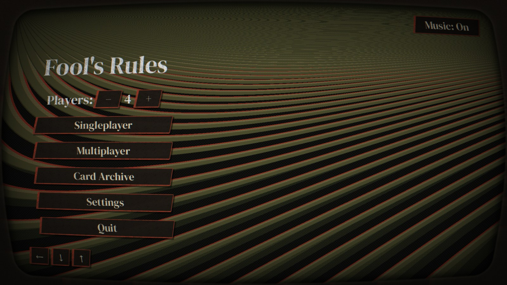
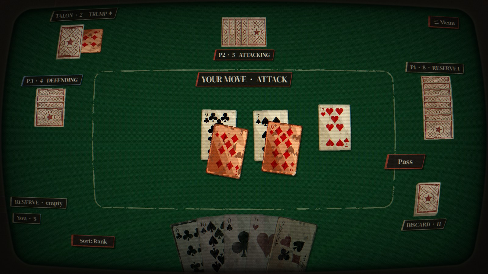
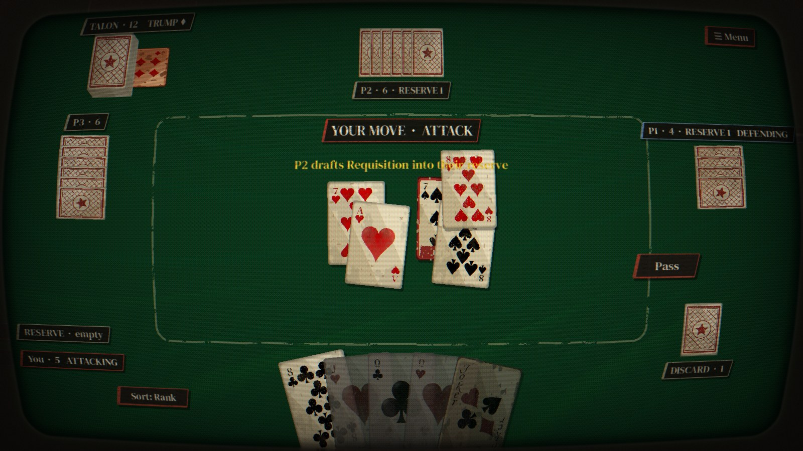
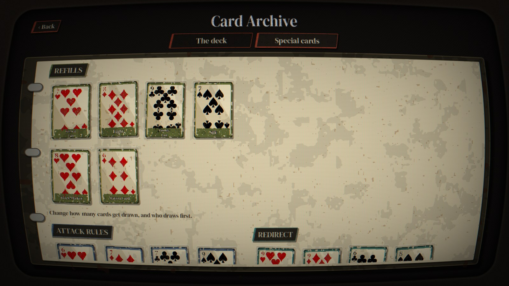
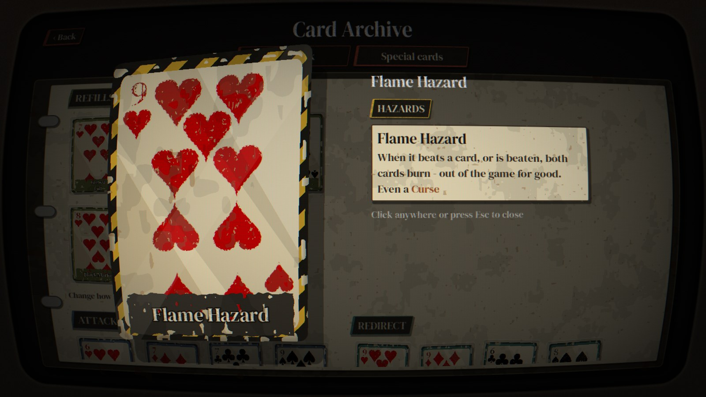
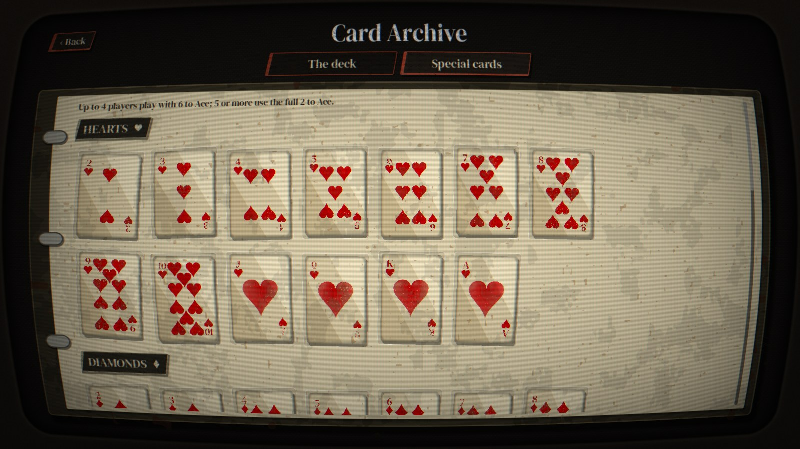

# Fool's Rules

**Durak, the old Russian card game, but the deck has started fighting back.**

Fool's Rules is a card roguelike built on top of Durak. The base game is simple: get rid of all your cards, and don't be the last one holding any. The last player left with cards is the *durak*, the fool. On top of that we've thrown in 33 special cards that bend the rules, plus a Joker, curses hidden in the deck, and hazards that set cards on fire or freeze them solid.

It all happens on a worn green felt table on a flickering old TV, in a Soviet post-apocalyptic setting. Every visual in the game is made with code and shaders, with no AI-generated art.



## What's in it

- **Classic Durak at its core.** Attack, defend, throw in matching ranks, pick up the pile when you can't hold. Play against 1 to 5 bots (the table goes bigger, but it's tuned for up to 6 players).
- **33 special cards in six families:**
  - **Refills** change how many cards get drawn, and who draws first.
  - **Attack Rules** bend how big an attack can get, and how you can give up or pass.
  - **Redirect** changes who has to defend.
  - **Tricks** let you cheat a little: peek, rig the deck, swap or steal.
  - **Curses** are bad cards hidden in the deck. Get rid of them fast.
  - **Hazards** are fire, fallout and frost. They burn, poison or freeze the cards themselves.
- **The Joker.** Unbeatable in defence, one per game. Just don't get stuck holding it last.
- **A draft.** Every so often the table pauses and everyone picks a special card for their reserve, a little shelf of cards that feeds into your next refills.
- **The Card Archive.** A binder with every card in the game. Flip through it and have a close look at each one.
- **Multiplayer over Steam**, with lobbies and invite codes.
- **Android version** (single-player). Hold your finger on a card to read it.

## Screenshots











## How to play

If you've never played Durak, here's the short version:

1. Everyone gets 6 cards. One suit is the **trump**, shown under the deck.
2. The attacker lays down a card. The defender has to beat it with a higher card of the same suit, or with any trump.
3. Other players can **throw in** more cards, as long as their rank is already on the table.
4. If the defender beats everything, the cards are discarded and the defender attacks next. If they can't, they **take** the whole pile into their hand.
5. Everyone refills to 6 from the deck. When the deck runs out, whoever empties their hand first is safe. The last one holding cards is the fool.

In the game, drag a card onto the table to attack, or onto an attack to beat it. Hover over any special card (or long-press on a phone) to see what it does. If a card in your hand can't be played, it's faded out, and hovering it tells you why.

## Running it from source

You'll need **[Godot 4.7.2](https://godotengine.org/)**.

1. Clone the repo.
2. Open `project.godot` in Godot.
3. Hit Play.

Single-player works out of the box. Multiplayer needs Steam running in the background (it uses the [GodotSteam](https://godotsteam.com/) extension in `addons/`). Without Steam, the Multiplayer button is just greyed out.

### Android

There's an `Android` export preset. You'll need the Android SDK and Godot's Android export templates installed. Then plug in a phone with USB debugging on and use the Android deploy button in the top right of the editor. The phone build is single-player only.

### Tests

The rules engine has a fuzz test that plays thousands of random games and checks nothing breaks along the way:

```
godot --headless --script res://scripts/tests/test_durak.gd
```

## Project layout

| Folder | What's in it |
| --- | --- |
| `scripts/core` | The rules engine, special card definitions and effects, and the bots. No UI code. |
| `scripts/ui` | The table, menu, Card Archive and card visuals. |
| `scripts/autoload` | Always-on stuff: Steam, networking, music and sound, the CRT effect, settings. |
| `shaders` | Card wear, the CRT, dither, worn panels and the rest of the look. |
| `scenes`, `themes`, `assets` | Scenes, the UI theme, and card art, fonts and audio. |

## Status

Still in active development. Things will change, break, and get rebalanced.
